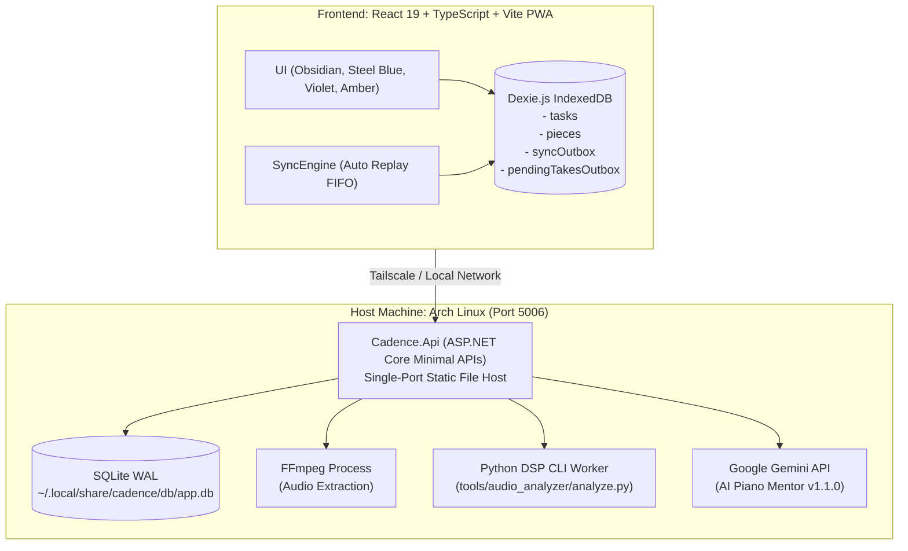

# Cadence 🎹

**Cadence** is a personal, self-hosted life organizer and piano repertoire studio engineered for Arch Linux and mobile devices (Android via Tailscale).

Cadence merges deliberate practice pedagogy (multi-take audio/video evaluation, deterministic weakness tracking, objective audio DSP metrics) with daily commitment planning (day archetypes, recurring tasks, and weekly overview).

---

## Architecture & Tech Stack



### Core Architectural Principles
1. **Single-Port Production Serving:** `Cadence.Api` hosts the compiled Vite React PWA directly from `wwwroot` alongside its Minimal API endpoints on port `5006`.
2. **Offline-First & Outbox Replay:** Built with `Dexie.js`. When the Arch Linux host is powered off or unreachable, reading tasks, viewing piece history, scheduling recurring commitments, and queuing practice take recordings (with media blobs) remain 100% functional on Android and desktop. As soon as the host reconnects, mutations and media takes are replayed in FIFO order.
3. **Deterministic Weakness State Machine:** C# domain logic manages weakness lifecycle (`Active` -> `Improving` -> `Resolved` -> `RegressedToday` / `PersistedToday`). Weakness progression is verified deterministically, never left to LLM hallucination.
4. **On-Demand Subprocess Audio DSP Worker:** Python digital signal processing runs strictly as an ephemeral subprocess (`tools/audio_analyzer/analyze.py`) in its own `.venv`, extracting tempo, tempo stability std dev, dynamic range, and anomaly spikes without consuming RAM 24/7.
5. **Strict Visual System:** Engineered in Obsidian (`#0B0E14`), Slate (`#111622`), vivid Steel Blue (`#3B82F6`), Deep Violet (`#8B5CF6`), and Warm Amber (`#F59E0B`). Zero green, cyan, or pink anywhere.

---

## Key Features

### 1. Life Organizer & Commitments
- **Day Archetypes:** Select daily focus (`DeepWorkHeavy`, `PianoHeavy`, `RestRecovery`, `Balanced`) with customized energy indicators.
- **Action Commitments:** Categorized tasks (`University`, `DeepWork`, `Piano`, `Gym`, `LifeAdmin`) with priorities (`P1`, `P2`, `P3`).
- **Recurring Commitments:** Support for `None`, `Daily`, `Weekdays`, and `Weekly`. Completing a recurring task automatically schedules the next occurrence.
- **Weekly Overview:** Toggle between Day View and a 7-day visual week overview with an unscheduled commitments backlog.
- **Piano Bridge:** Piano action items directly link into the piece's workspace.

### 2. Piano Repertoire Studio & Multi-Take Coaching
- **Curated Repertoire Buckets:** `MainChallenge`, `Maintenance`, `FutureExploration`.
- **Score Transparency & PDF Viewer:** Embed and view PDF sheet music with epistemic capability tiers (`VisualPdfOnly` vs `None`).
- **Deterministic Weakness Tracker:** Categorized weaknesses (`PitchAccuracy`, `RhythmAndTempo`, `DynamicsAndBalance`, `Voicing`, `ArticulationAndPedal`, `PhrasingAndRubato`, `PhysicalTension`) tracked across practice sessions.
- **Practice Take Studio:** Record or upload `.mp3`, `.wav`, or `.mp4` video takes. Optional video posture analysis evaluates wrist angle and forearm alignment.
- **Offline Take Queueing:** If recorded while disconnected from the host, the media blob is saved locally in IndexedDB and marked as `"Queued for Maestro Analysis (Waiting for Host)"`. Automatically uploads when reconnected.
- **Pedagogical Assessment Card:** AI Piano Mentor critiques with intra-session comparisons, DSP evidence badges, timestamps, and immediate next-take drills.

---

## Directory Structure

```text
Cadence/
├── src/
│   ├── Cadence.Api/               # ASP.NET Core Minimal APIs & Static Web Host
│   │   ├── Domain/                # Entities, Enums, Weakness State Machine
│   │   ├── Features/              # Endpoints & DTOs (Organizer, Library, Mentor, System)
│   │   ├── Infrastructure/        # Storage, FFmpeg, Python DSP Runner, DB Interceptors
│   │   └── wwwroot/               # Compiled React PWA distribution
│   └── web-client/                # React 19 + TypeScript + Vite PWA + Tailwind
│       ├── src/features/          # Organizer & Music Workspace views
│       ├── src/services/          # API client, Dexie.js DB, SyncEngine
│       └── src/types/             # Shared TypeScript schemas matching v1.1.0 contract
├── tools/
│   └── audio_analyzer/            # Standalone Python Audio DSP CLI Worker
│       ├── analyze.py             # Librosa/Scipy onset, tempo & RMS analyzer
│       └── requirements.txt       # Pinned Python dependencies
├── tests/
│   └── Cadence.Api.Tests/         # xUnit Domain & State Machine Tests
├── .env.example                   # Sample environment file for ~/.config/cadence/cadence.env
└── deploy/                        # Arch Linux deployment & systemd user services
    ├── build-release.sh           # Staged atomic production build & publish script
    ├── rollback-release.sh        # Atomic release rollback script
    ├── backup-db.sh               # SQLite hot online backup + media sync script
    ├── restore-db.sh              # Verified WAL-safe SQLite restore script
    ├── install-systemd.sh         # Systemd user units installer (parameterized paths)
    └── systemd/                   # User unit definitions (.service, .timer)
```

---

## Getting Started & Development

### Prerequisites
- .NET 10 SDK
- Node.js (v20+) & npm
- Python 3.10+ (with `venv`)
- FFmpeg (for media audio extraction)
- SQLite3 CLI

### Python DSP Virtual Environment Setup
Initialize the DSP worker virtual environment with the pinned dependency versions in `tools/audio_analyzer/requirements.txt`:
```bash
cd tools/audio_analyzer
python3 -m venv .venv
.venv/bin/pip install --upgrade pip
.venv/bin/pip install -r requirements.txt
```
At runtime, `Cadence.Api` resolves the worker script and Python interpreter explicitly via `Cadence:DspScriptPath` / `CADENCE_DSP_SCRIPT` and `Cadence:DspPythonPath` / `CADENCE_DSP_PYTHON`, defaulting to the `tools/audio_analyzer/analyze.py` bundled inside the published release directory.

### Local Development

1. **Start the Backend API:**
   ```bash
   dotnet run --project src/Cadence.Api --urls "http://127.0.0.1:5006"
   ```

2. **Start the React Frontend (Vite Dev Server):**
   ```bash
   cd src/web-client
   npm install
   npm run dev
   ```
   Open `http://localhost:5173`. Requests to `/api/*` are automatically proxied to port `5006`.

3. **Run Tests:**
   ```bash
   dotnet test Cadence.sln
   ```

---

## Production Build & Arch Linux Deployment

### 1. Build Single-Port Production Release (Staged & Reversible)
Run the automated build script:
```bash
./deploy/build-release.sh
```
This builds the React PWA, initializes/updates the Python DSP virtualenv, publishes `Cadence.Api` (including `wwwroot/` and `tools/audio_analyzer/`) into a new timestamped release directory under `deploy/releases/release-<timestamp>-<sha>/`, verifies the build, and atomically flips the `deploy/current` symlink (preserving the prior release at `deploy/previous`). If any step fails, the incomplete staging directory is removed and the active release remains untouched.

To roll back to the previous release at any time:
```bash
./deploy/rollback-release.sh
systemctl --user restart cadence.service
```

To test the compiled single-port release locally on loopback:
```bash
./deploy/current/Cadence.Api --urls "http://127.0.0.1:5006"
```
Visit `http://127.0.0.1:5006/` in any browser.

---

### 2. Arch Linux Systemd User Service & Environment Secrets

Cadence runs cleanly under user systemd (`systemd --user`) without requiring root privileges.

1. **Configure Environment & Secrets (`~/.config/cadence/cadence.env`):**
   Secrets (such as `GEMINI_API_KEY`) and local overrides live in `~/.config/cadence/cadence.env` (mode `0600`), loaded automatically by `cadence.service` via `EnvironmentFile=-%h/.config/cadence/cadence.env` so tracked files never need to be edited:
   ```bash
   mkdir -p -m 700 ~/.config/cadence
   cp .env.example ~/.config/cadence/cadence.env
   chmod 600 ~/.config/cadence/cadence.env
   ```

2. **Install and Enable Units:**
   ```bash
   ./deploy/install-systemd.sh
   ```
   *(Optional: set `CADENCE_INSTALL_ROOT=/path/to/Cadence` to install against a custom path; defaults to the repository directory.)*
   This renders and installs:
   - `~/.config/systemd/user/cadence.service`: Starts `deploy/current/Cadence.Api` bound to loopback (`127.0.0.1:5006`) on boot and restarts on failure.
   - `~/.config/systemd/user/cadence-backup.timer`: Daily SQLite hot backup timer at 03:30 AM.
   - `~/.config/systemd/user/cadence-backup.service`: Runs `deploy/backup-db.sh`.

3. **Check Service Status:**
   ```bash
   systemctl --user status cadence.service
   journalctl --user -u cadence.service -f
   ```

4. **Check Backup Timer:**
   ```bash
   systemctl --user list-timers --user | grep cadence
   ```

---

### 3. Remote Access via Tailscale Serve (HTTPS on Loopback)

By default, `cadence.service` binds strictly to `http://127.0.0.1:5006` so unauthenticated API routes are not exposed on local Wi-Fi/LAN interfaces. Tailscale Serve terminates HTTPS for your tailnet and proxies traffic to loopback port `5006`:

1. **Ensure Cadence is running on loopback port 5006** (`cadence.service`).
2. **Expose loopback port 5006 over Tailscale HTTPS:**
   ```bash
   tailscale serve --bg http://127.0.0.1:5006
   ```
   *(To inspect or stop serving: `tailscale serve status` / `tailscale serve reset`.)*
3. Open your Tailscale machine HTTPS URL (e.g., `https://arch-host.tailnet.ts.net`) in Chrome on Android.
4. Tap **Install App** / **Add to Home screen**. The dark-themed Cadence PWA will install as a standalone mobile application with full offline caching and outbox synchronization.

> **Opt-in Direct LAN Mode:** If you intentionally want to expose Cadence directly on all network interfaces without Tailscale Serve, set `ASPNETCORE_URLS=http://0.0.0.0:5006` in `~/.config/cadence/cadence.env` and restart `cadence.service`. Only enable this on a trusted private network.

---

## Data Management & Backups

All state is preserved under `~/.local/share/cadence/` (or the path configured via `Cadence:StorageRoot` / `CADENCE_STORAGE_ROOT`) with private directory (`0700`) and file (`0600`) permissions:
- `~/.local/share/cadence/db/app.db`: SQLite database in Write-Ahead Logging (WAL) mode (`app.db-wal` and `app.db-shm` sidecars exist while active).
- `~/.local/share/cadence/media/`: Uploaded score PDFs and recorded take media. **Note:** SQLite `.db` backups contain relational metadata only and do **not** embed score PDFs or audio/video files.
- `~/.local/share/cadence/backups/`:
  - `cadence-YYYYMMDD_HHMMSS_fff-<id>.db`: Atomic online SQLite backups created via `POST /api/system/backup` or `deploy/backup-db.sh` (serialized via `.backup.lock`, retaining the latest `Cadence:BackupRetentionCount` / `CADENCE_BACKUP_RETENTION_COUNT` snapshots, default `30`).
  - `media/`: Additive copy of the `media/` directory maintained by `deploy/backup-db.sh` (never pruned by the script, so media deleted in the app stays recoverable; an empty media directory is skipped rather than wiping the copy).
  - `pre-restore/`: Timestamped safety snapshots of `app.db`, `app.db-wal`, and `app.db-shm` captured automatically before any restore.

To perform a manual hot backup (both SQLite database and `media/` directory) at any time:
```bash
./deploy/backup-db.sh
```

To safely restore from a database backup (never copy a backup directly over `app.db` while stale `-wal`/`-shm` sidecars remain):
```bash
systemctl --user stop cadence.service
./deploy/restore-db.sh ~/.local/share/cadence/backups/cadence-YYYYMMDD_HHMMSS_fff-XXXXXXXX.db
systemctl --user start cadence.service
```
`deploy/restore-db.sh` refuses to run while `cadence.service` is active, stages and verifies the candidate backup with `PRAGMA integrity_check` and `PRAGMA foreign_key_check` before touching `db/`, archives the existing `app.db` and `-wal`/`-shm` sidecars into `backups/pre-restore/`, removes stale WAL/SHM sidecars, and atomically moves the verified database into place.
